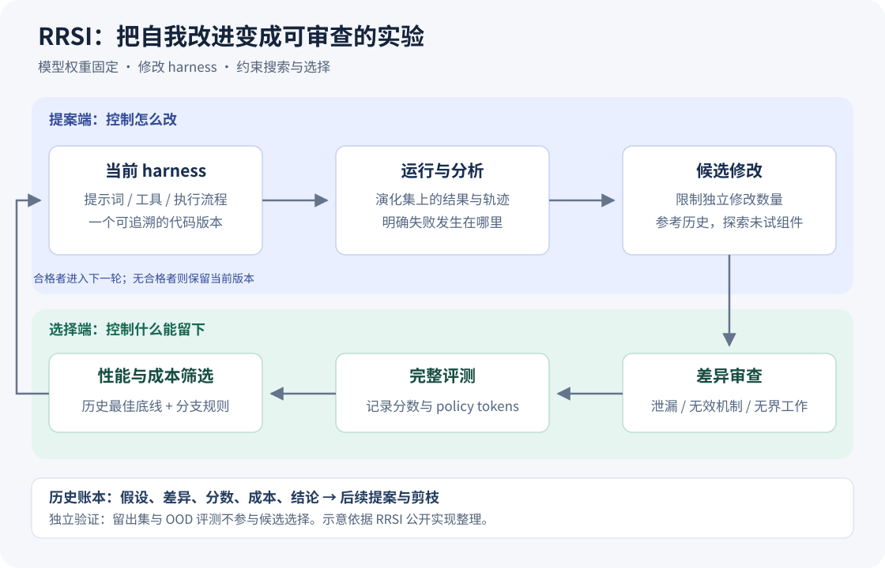
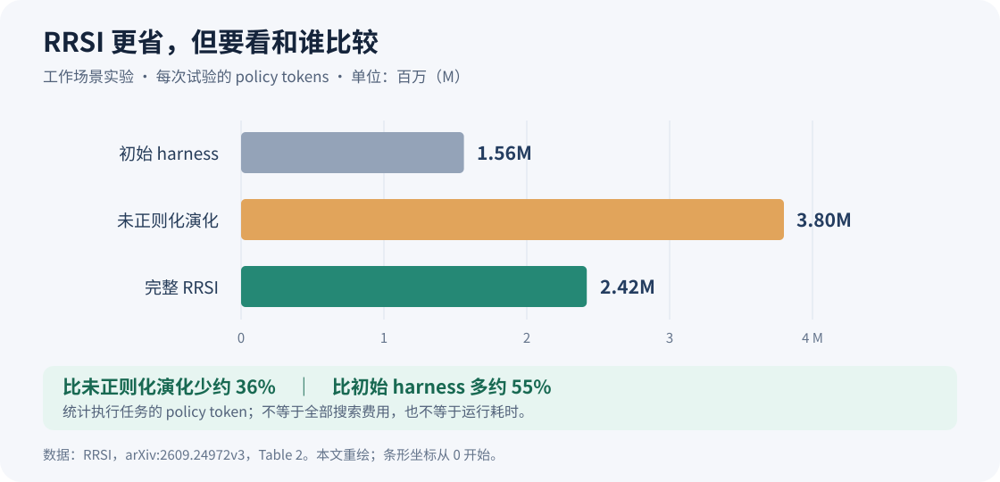

让一个 Agent 跑任务，读失败日志，修改自己的提示词和工具，再跑一轮。如果分数提高，就保留修改。

这个循环很诱人：原本需要工程师逐条翻日志的工作，似乎可以交给 Agent 自己完成。但有个问题：**它变得更会做事了，还是更熟悉那批反复出现的题了？**

RRSI（Regularized Recursive Self-Improvement of Agent Harnesses）研究的就是这个问题。它保持底座模型权重不变，让 Agent 改进自己的运行框架，同时约束修改和筛选过程，争取把评测上的进步变成能迁移的能力。下面从一个报表任务出发，拆开这套机制，再看实验到底支持了什么。[项目介绍](https://github.com/google-research/rrsi)

<!--more-->

## 1. 模型没换，Agent 到底在改什么？

想象一个负责月度报表的 Agent：读取 CSV，计算收入，画图，最后交付分析报告。这里的案例用于解释机制，并非论文中的实际任务或实验结果。

即使模型知道怎么计算收入，任务仍然可能失败：它没有检查字段类型，把退款算成收入；长日志挤掉了最初的要求；文件生成后没有检查，就宣布完成。

围绕模型安排这些工作的代码与规则，就是 **harness**。可以把它理解为 Agent 的运行框架：模型何时收到什么信息、能调用什么工具、遇到错误怎么恢复、什么时候结束工作。

| 可以修改的部分 | 在报表任务中的例子 |
| --- | --- |
| 提示词与工具说明 | 计算前检查日期、币种和缺失值 |
| 控制流程与配置 | 命令失败后先检查原因，再做有界重试 |
| 上下文管理 | 压缩冗长输出，同时保留原始交付要求 |
| 工具与技能 | 增加可复用的数据校验工具或操作步骤 |
| 记忆与子 Agent | 保存通用经验，或委派一次范围明确的检查 |

这些都属于公开实现中的可编辑组件。注意“保存通用经验”与“记住某道评测题的答案”有实质差别，后面会看到 RRSI 如何审查它。[组件定义](https://github.com/google-research/rrsi/blob/be50316e1db05914068a973f322770ef08ed7ba1/rrsi/components.py)

这里的“递归”，发生在系统层面：当前系统运行产生反馈，反馈推动 harness 修改，修改后的系统又产生下一轮反馈。一次任务内的反思只有变成可保留、可评估的框架修改，才进入这个跨轮演化过程；它不涉及模型权重训练。[演化主循环](https://github.com/google-research/rrsi/blob/be50316e1db05914068a973f322770ef08ed7ba1/rrsi/loop.py)

## 2. 为什么自己改自己，也会过拟合？

回到报表 Agent。假设它在一批固定任务上反复运行，发现某份 CSV 的日期列总叫 `order_date`，就加了一条规则：碰到这份文件，直接按某种格式解析。

眼前的错误减少了。但下一份报表换了列名，它又失败了。

更隐蔽的情况是，它每次失败都增加一道检查：重读全部文件、再算一遍、再找一个模型复核。分数可能上升，消耗的时间和 token 也不断增加。仅看成功率，很难分清收益来自更好的机制，还是更多的计算。

这些是假想情况，但它们揭示了固定反馈集的风险：**被反复用来指导修改的评测集，已经成为优化过程的一部分。** 即使不更新模型参数，提示词、代码和记忆同样能适应这些任务。

因此，需要区分三种材料：

- **演化集（evolve set）**：反复运行，供系统分析失败、选择修改。
- **同分布留出集（ID held-out）**：任务来自相似分布，但不参与修改决策。
- **分布外评测（OOD）**：换一套任务，检查改进能否迁移。

RRSI 的实验采用了这样的区分。衡量进步时，应把演化集成绩和未参与搜索的成绩分别列出。[论文实验设置](https://arxiv.org/html/2609.24972v3#S4.SS1)

## 3. RRSI 怎样完成一轮改进？

RRSI 保留了“运行—反馈—修改—评估”的循环，把约束放在两个位置：提案时控制一次怎么改，选择时控制哪些修改能留下。



*本文绘制的机制示意图，依据公开实现整理；不是论文原图。留出集与 OOD 评测不进入图中的候选选择反馈。*

公开代码为不同候选建立独立的 Git worktree，使它们从同一个当前版本出发。通过筛选的获胜候选进入演化分支；没有合格候选时保留当前版本。这样，每一轮都有可追溯的代码版本和决策记录。[主循环实现](https://github.com/google-research/rrsi/blob/be50316e1db05914068a973f322770ef08ed7ba1/rrsi/loop.py)

关键问题随之变成：什么样的修改值得尝试，什么样的改善值得相信？

## 4. 提案端：让每次修改能被解释

### 一次少改一点，才知道什么有效

如果报表 Agent 一口气改了提示词、解析器、重试次数和复核流程，最后多做对两道题，我们很难说清是哪项修改起了作用。

RRSI 给每个候选设置独立修改数量的上限，并随演化轮次逐渐收紧。早期留出组合探索的空间，后期提高可归因性。预算限制的是独立机制数量，不能简单按改了几行代码来理解。[预算调度](https://github.com/google-research/rrsi/blob/be50316e1db05914068a973f322770ef08ed7ba1/rrsi/schedule.py)、[提案约束](https://github.com/google-research/rrsi/blob/be50316e1db05914068a973f322770ef08ed7ba1/rrsi/propose.py)

比如，“识别工具超时并做一次有限重试”可能需要修改多行代码，但仍是一个机制；“加重试、改币种规则、增加复核 Agent”则是几个独立变化。

### 失败的尝试，也要进入经验

每项经过测量的修改会记录所属组件、假设、代码差异、分数与成本变化，以及是否被接受。后续提案可以利用这些记录，减少把失败方案换个说法再试一遍的情况。

这里有个限制：一个候选包含多项修改时，它们共享候选层面的测量结果，不能把整包收益直接当作每个组件的独立贡献。记录历史改善了证据管理，还没有自动完成因果归因。[历史记录实现](https://github.com/google-research/rrsi/blob/be50316e1db05914068a973f322770ef08ed7ba1/rrsi/history.py)

### 卡住时，换一个还没试过的部件

假如连续几轮只在改“请认真检查”的措辞，进步始终没有超出噪声，问题可能根本不在提示词。

公开实现会根据最近几轮的进展判断是否停滞，并为尚未实际测量过的组件保留探索名额。对报表 Agent 来说，这可能意味着从继续改提示词，转向尝试上下文管理或数据校验工具。探索方向改变后，候选仍需通过审查和选择。[探索逻辑](https://github.com/google-research/rrsi/blob/be50316e1db05914068a973f322770ef08ed7ba1/rrsi/history.py)

## 5. 选择端：涨分，还不足以留下来

### 先检查是否把题目写进了系统

RRSI 在完整评测前审查候选差异，关注任务名称、实体、特定答案、评测专用逻辑，以及运行时记忆是否会跨试验保存题目内容。它也检查新增机制是否实际生效、是否引入没有退出条件的工作循环。[审查实现](https://github.com/google-research/rrsi/blob/be50316e1db05914068a973f322770ef08ed7ba1/rrsi/critic.py)

对报表案例，下面两种修改就应区别对待：

| 修改 | 判断重点 |
| --- | --- |
| “读取日期列后检查解析失败比例，异常时报告原因” | 能否适用于新的数据文件？ |
| “遇到某个评测文件就填入上次得到的收入总额” | 是否把已见任务的答案带入后续执行？ |

这种审查能减少明显泄漏，但审查器也可能漏判。是否学到可迁移机制，仍要用未参与演化的任务检验。

### 先测量不改代码时，分数会波动多少

Agent 的运行带有随机性。同一版本跑两次，结果也可能不同。RRSI 用噪声容忍度 `δ` 表达这种波动范围；公开代码支持从重复基线评测或单次基线中的试验重采样来估计它。各领域配置也可以直接指定该值。[噪声校准](https://github.com/google-research/rrsi/blob/be50316e1db05914068a973f322770ef08ed7ba1/rrsi/calibrate.py)

假设一个完全没改的 Agent 多次运行就在 78 到 80 分附近波动，那么某个修改跑出 79.5 分，单凭这一次结果，很难认定它改善了能力。这是解释用的数字，不是论文结果。

### 用历史最佳分数设底线，再判断成本

选择器使用的性能底线可以写成：

```text
候选分数 ≥ 已接受演化路径的历史最高分数 − δ
```

历史最高分数不会随着当前版本的小幅回落而降低。这样可以约束多次“这轮只退一点”累积成明显退化的情况。

过了底线还要看成本。若相对当前版本的涨分超过 `δ`，允许的 token 增长随收益增加；噪声带内则综合分数变化、成本节省和结构新颖性，具体权重按领域配置。因而，“小于噪声带的涨分一律拒绝”并不是准确概括；降低成本的候选仍可能留下。最后在合格候选中选分数最高者。[选择器实现](https://github.com/google-research/rrsi/blob/be50316e1db05914068a973f322770ef08ed7ba1/rrsi/selection.py)

这里的结构新颖性也有明确范围：公开代码只对尚未出现在获胜修改中的工具、技能、记忆、子 Agent 组件类型计数。它不是“只要想法新就加分”。[新颖性定义](https://github.com/google-research/rrsi/blob/be50316e1db05914068a973f322770ef08ed7ba1/rrsi/components.py)

### 让不再有贡献的结构，有机会被删除

假设早期加了一个复核模块，后来数据校验工具已经解决了同样的问题，复核模块却还在每次执行时消耗 token。

RRSI 的历史模块会把近期没有产生正向测量收益的组件列为剪枝目标，交给后续提案尝试移除。这里的“没有贡献”是基于记录的启发式判断；删除候选还要经过评估，不能视为证明该组件永远无用。[剪枝目标生成](https://github.com/google-research/rrsi/blob/be50316e1db05914068a973f322770ef08ed7ba1/rrsi/history.py)

论文将修改稀疏性、结构剪枝和复杂度约束分别类比为 L0、L1、L2 风格的正则化。对应的是搜索行为，不能理解为给语言模型的训练损失增加了三项惩罚。[正则化视角](https://arxiv.org/html/2609.24972v3#S3.SS1)

## 6. 实验最有意思的地方：演化集涨得少，迁移反而更好

以下采用 2026 年 10 月 4 日的论文 v3。工作场景实验使用冻结的 Claude Opus 4.8，从 Harvey LAB 演化，OOD 平均分取 JobBench、GDPval、APEX-Agents 三项。表内为论文报告值，不是本文复现。

| 方法 | 演化集 | 同分布留出集 | OOD 平均 | Policy tokens / trial |
| --- | ---: | ---: | ---: | ---: |
| 初始 harness | 89.4 | 86.9 | 39.7 | 1.56M |
| 未正则化演化 | 92.8 | 88.9 | 40.3 | 3.80M |
| 去掉提案端约束 | 90.7 | 88.8 | 41.9 | 2.69M |
| 去掉接受端约束 | 91.5 | 88.7 | 41.0 | 3.59M |
| 完整 RRSI | 90.5 | 89.2 | 43.6 | 2.42M |

数据来源：[论文 v3，表 2](https://arxiv.org/html/2609.24972v3#S4.SS3)。

在这组消融中，未正则化演化在演化集上涨得更多，OOD 收益却很小；完整 RRSI 的演化集分数较低，OOD 表现更好。去掉任一组约束，迁移分数都会下降。

成本也必须带着比较对象读：`1 − 2.42 / 3.80 ≈ 36.3%`，所以完整 RRSI 比未正则化演化少用约 36% policy tokens；但相对初始 harness，`2.42 / 1.56 − 1 ≈ 55.1%`，它仍然更贵。这两点可以同时成立。



*依据论文表 2 重绘。此处统计执行任务的 policy token，不代表包含提案、分析、审查与全部搜索试验的总研发费用。*

另一个应注意的口径问题：v3 摘要写 OOD 最大提升 4.3 点，而表格中的 JobBench 是 36.0 → 40.7，即 +4.7 点。本文采用具体表格，不混用摘要与项目主页的总括数字。[v3 摘要](https://arxiv.org/abs/2609.24972v3)、[结果表](https://arxiv.org/html/2609.24972v3#S4.SS2)

## 7. 这些结果还不能回答什么？

首先，有限任务上的迁移改善，还不能保证遇到任意业务都有效。报表 Agent 换一家公司的文件尚且可能失败，更不用说更换工具接口、工作流程和验收方式。独立留出评测应当作为每个应用自己的证据。

其次，噪声带处理的是测量波动，不能消除所有过拟合。如果持续查看 OOD 结果，并根据它调整系统，那套 OOD 任务也逐渐参与了优化，需要再保留独立材料。

再次，组件标签和历史收益是实用线索，不能替代针对性的消融。某个复核模块短期看不到收益，可能已经冗余，也可能恰好负责少见但重要的失败场景。

还有一个复现时容易忽略的实现细节：公开版本的预算调度在 `t = 0 … T−1` 上取样，并向上取整。按该版本计算 `T=8、b_min=1、b_max=4`，预算序列为 `[4, 4, 4, 4, 3, 2, 2, 2]`，因此配置中的最小预算为 1，不等于实际最后一轮一定执行单项修改。复现应固定代码版本并检查实际运行参数。[调度代码](https://github.com/google-research/rrsi/blob/be50316e1db05914068a973f322770ef08ed7ba1/rrsi/schedule.py)

这些边界提醒我们：递归自我改进仍然需要实验设计、版本管理和资源核算。自动化可以扩大尝试范围，结论的可信度还要由证据支撑。

## 8. 给自己的 Agent 做改进，可以先检查这张表

下面是从上述机制提炼的工程检查表，供迁移到自己的系统时使用，不是论文的额外实验结论。

| 检查项 | 要留下的证据 |
| --- | --- |
| 这次到底改了什么？ | 代码版本、独立修改清单、每项修改的假设 |
| 什么都不改，结果会波动多少？ | 重复基线的分数、失败分布和成本 |
| 是否带入了任务答案？ | 对差异与跨任务持久化内容的审查记录 |
| 收益来自机制，还是更多计算？ | 同口径的质量、token、耗时与重试统计 |
| 哪些失败已经尝试解决？ | 成功与失败方案共用的历史账本 |
| 新增模块是否仍有用？ | 移除或替代它的对照评估 |
| 换一批任务还有效吗？ | 不参与提案、调参和选择的独立评测 |
| 怎样复现或回退？ | 固定的模型、工具、数据、配置和代码版本 |

对报表 Agent，可以先把“日期解析失败”的日志变成一个通用校验机制，在固定条件下评估，再拿没有参与修改的新报表验证。材料不足以支持时，就保留问题和失败记录，继续下一轮。

RRSI 带来的启发，是把“自己改自己”变成一种有约束的实验过程：每次修改提出可检查的假设，每次保留都交代收益与代价，再用没见过的任务检验进步。这样，涨分才有机会转化为真正可复用的工作能力。

## 参考资料

- [论文：RRSI，arXiv v3，2026-10-04](https://arxiv.org/html/2609.24972v3)
- [项目主页与逐轮演化记录](https://regularized-rsi.com/)
- [公开代码：固定到 be50316](https://github.com/google-research/rrsi/tree/be50316e1db05914068a973f322770ef08ed7ba1)

本文为论文与公开代码解读；报表案例和工程检查表为说明性整理。数值结果来自作者报告，未进行完整基准复现。
